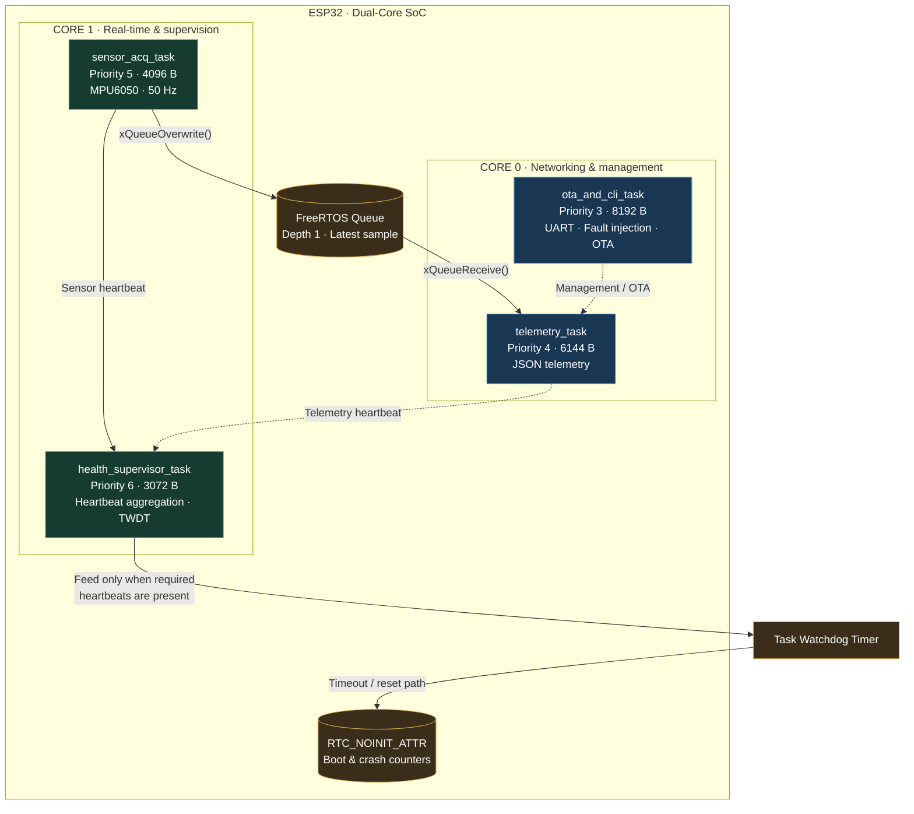
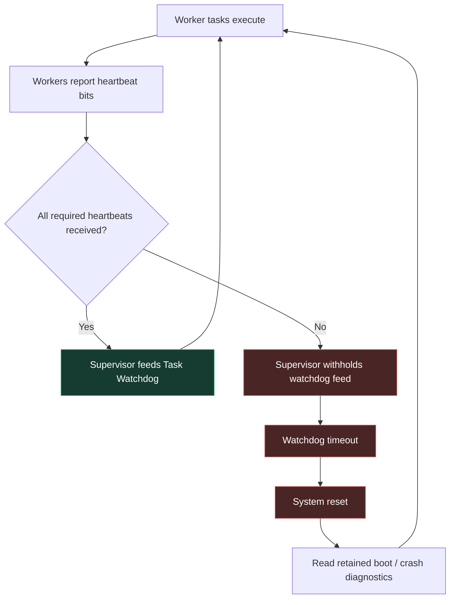
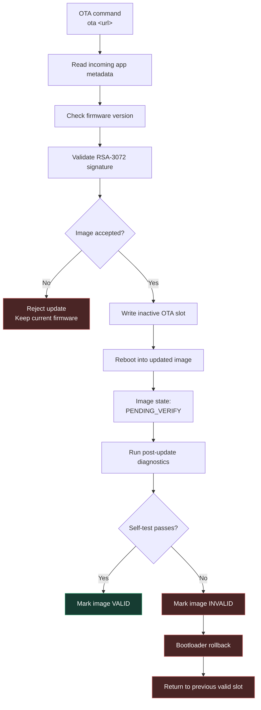

<div align="center">

# ESP32 Fault-Tolerant RTOS & Secure OTA

### A reliability-focused embedded telemetry node with dual-core task isolation, watchdog-driven recovery, persistent crash diagnostics, and cryptographically signed firmware updates.

<p>
  <a href="https://docs.espressif.com/projects/esp-idf/"></a>
  
  
  
  
</p>

**Fault detection · Automatic recovery · Secure updates · Persistent diagnostics**

</div>

---

## Project at a glance

This project explores how an ESP32-based embedded node can remain recoverable when individual tasks fail and how firmware can be updated without blindly trusting a newly installed image.

| Area | Design |
|---|---|
| Processing | ESP32 dual-core, FreeRTOS SMP |
| Sensor | MPU6050 accelerometer / gyroscope over I²C |
| Acquisition | 50 Hz periodic sampling |
| Task health | EventGroup heartbeats + Task Watchdog Timer |
| Crash history | RTC slow-memory counters using `RTC_NOINIT_ATTR` |
| Firmware updates | RSA-3072 signed OTA images |
| Update strategy | Dual application slots (`ota_0` / `ota_1`) |
| Recovery | ESP-IDF first-boot verification and rollback |

## 01 · System architecture

The firmware separates periodic sensor acquisition and health supervision from telemetry, networking, and update management. Sensor samples are passed through a depth-one queue so the consumer receives the latest available frame instead of processing an accumulating backlog.



### Task allocation

| Task | Core | Priority | Stack | Main responsibility |
|---|:---:|:---:|---:|---|
| `health_supervisor_task` | 1 | **6** | 3072 B | Waits for required worker heartbeats and feeds the hardware TWDT only when they are present. |
| `sensor_acq_task` | 1 | 5 | 4096 B | Reads the MPU6050 at 50 Hz using `vTaskDelayUntil()`, publishes a sample, and signals its heartbeat. |
| `telemetry_task` | 0 | 4 | 6144 B | Consumes sensor frames, formats JSON telemetry, reports crash counters, and signals its heartbeat. |
| `ota_and_cli_task` | 0 | 3 | 8192 B | Handles UART commands, fault-injection input, version checks, and signed OTA operations. |

### Sensor data path

| Stage | Behavior |
|---|---|
| Acquire | Read accelerometer, gyroscope, and temperature data from the MPU6050. |
| Publish | Write the latest sensor frame to a FreeRTOS queue of depth one. |
| Replace | `xQueueOverwrite()` replaces the previous queued frame when the queue is full. |
| Consume | The telemetry task reads the latest available frame and emits structured JSON. |

> **Why a depth-one queue?** Telemetry is interested in the freshest sensor state. Replacing an old pending sample avoids building a queue of stale readings when the consumer is delayed. `xQueueOverwrite()` copies the queue item; it is not a zero-copy transfer.

## 02 · Fault detection & recovery

A worker task reports that it is alive by setting its assigned EventGroup heartbeat bit. The supervisor waits for the required set of heartbeats before resetting the Task Watchdog Timer.



### Persistent diagnostics

The project uses `RTC_NOINIT_ATTR` to retain diagnostic counters in RTC slow memory across applicable reset paths.

| Diagnostic | Purpose |
|---|---|
| Boot count | Tracks how many times the application has started. |
| Watchdog / panic crash count | Records observed watchdog or panic-related failures. |
| Reset reason | Helps distinguish watchdog resets from other reset causes. |

This avoids repeatedly writing these counters to flash. RTC-retained memory is not guaranteed to survive every reset condition or complete power loss.

## 03 · Secure OTA update lifecycle

The OTA flow combines signed-image validation with two application slots. A downloaded image is written to the inactive slot; the newly selected image must then pass its first-boot checks before it is confirmed.



### Update stages

| Stage | Description |
|---|---|
| 1 · Receive | The device starts an update from the supplied firmware URL. |
| 2 · Inspect | Application metadata and firmware version are checked. |
| 3 · Verify | The configured RSA-3072 signing mechanism validates the image. |
| 4 · Install | The accepted image is written to the inactive application slot. |
| 5 · Boot | The bootloader starts the new image in `ESP_OTA_IMG_PENDING_VERIFY`. |
| 6 · Test | The application runs its post-update health checks. |
| 7 · Confirm / revert | A passing image is marked valid; a failing image is rejected so the bootloader can roll back. |

The project enables rollback support with:

```ini
CONFIG_BOOTLOADER_APP_ROLLBACK_ENABLE=y
```

The application must also implement the appropriate first-boot diagnostics and OTA state transitions. Enabling the configuration alone does not perform the self-test or confirm the image.

### RSA-3072 signing configuration

The documented setup uses ESP-IDF signed-app verification without hardware Secure Boot eFuse enforcement:

```ini
CONFIG_SECURE_SIGNED_APPS_NO_SECURE_BOOT=y
CONFIG_SECURE_SIGNED_ON_UPDATE_NO_SECURE_BOOT=y
CONFIG_SECURE_BOOT_VERIFICATION_KEY="keys/ota_public_key.bin"
```

**Key handling**

| Key | Role | Handling |
|---|---|---|
| `ota_private_key.pem` | Signs firmware images | Keep secret; never commit to the repository. |
| `ota_public_key.bin` | Verifies signed firmware | Used by the firmware verification configuration. |

This signed-update configuration should not be confused with hardware-enforced Secure Boot. It demonstrates signed firmware validation without permanently burning Secure Boot eFuses.

## 04 · Hardware & wiring

### Required hardware

| Component | Specification |
|---|---|
| Development board | ESP32 DevKitC / ESP32-WROOM-32 |
| Flash | 4 MB SPI flash |
| IMU | MPU6050 6-axis accelerometer / gyroscope |
| Sensor I²C address | `0x68` |
| Serial connection | USB-to-UART |

### MPU6050 connections

| MPU6050 pin | ESP32 pin |
|---|---|
| `SDA` | `GPIO 21` |
| `SCL` | `GPIO 22` |
| `VCC` | `3.3V` |
| `GND` | `GND` |

### Onboard controls

- `GPIO 0` — BOOT button, used as the documented physical fault-injection input.
- `GPIO 2` — Status heartbeat LED.

> **Sensor fallback:** If the MPU6050 is not detected during boot, `sensor_driver.c` logs a warning and uses deterministic simulated IMU waveforms. This keeps the RTOS and OTA paths testable without the physical sensor. Simulated data is not a substitute for real sensor measurements.

## 05 · Flash partition layout

Configured for a 4 MB SPI flash device with redundant OTA metadata and a dedicated ELF coredump partition.

| Partition | Type / subtype | Offset | Size | Purpose |
|---|---|---:|---:|---|
| `nvs` | `data / nvs` | `0x009000` | 24 KB | Wi-Fi credentials and persistent calibration |
| `otadata` | `data / ota` | `0x00F000` | 8 KB | OTA boot metadata and sequence counters |
| `phy_init` | `data / phy` | `0x011000` | 4 KB | RF PHY calibration |
| `ota_0` | `app / ota_0` | `0x020000` | 1.75 MB | Primary application slot |
| `ota_1` | `app / ota_1` | `0x1E0000` | 1.75 MB | Secondary OTA application slot |
| `coredump` | `data / coredump` | `0x3A0000` | 64 KB | ELF crash coredump storage |

## 06 · Build & deployment

### Prerequisites

- Visual Studio Code
- PlatformIO IDE extension
- ESP-IDF v5.x-compatible PlatformIO environment
- Python 3
- ESP32 board with 4 MB flash
- USB data cable
- A reachable 2.4 GHz Wi-Fi network for networking and OTA tests

### 1. Clone the repository

```bash
git clone <repository-url>
cd esp32-fault-tolerant-rtos-ota
```

Replace `<repository-url>` with the actual repository URL.

### 2. Generate signing keys

Create the key directory and generate the RSA-3072 key pair:

```bash
mkdir -p keys

espsecure.py generate_signing_key --version 2 --scheme rsa3072 keys/ota_private_key.pem

espsecure.py extract_public_key --version 2 --keyfile keys/ota_private_key.pem keys/ota_public_key.bin
```

Keep `keys/ota_private_key.pem` outside version control. Confirm that your `.gitignore` excludes private key material.

### 3. Configure Wi-Fi

Set the project's Wi-Fi configuration symbols in the appropriate local configuration:

```ini
CONFIG_NODE_WIFI_SSID="Your_2.4GHz_SSID"
CONFIG_NODE_WIFI_PASSWORD="Your_WiFi_Password"
```

Do not commit real credentials to the repository.

### 4. Build, flash & monitor

Connect the board, select the correct PlatformIO environment and serial port, then run:

```bash
pio run -t upload -t monitor
```

**Serial monitor:** `115200` baud.

### 5. Build and serve a signed OTA image

Update the application version in the project configuration:

```ini
CONFIG_APP_PROJECT_VER="1.1.0"
```

Build the firmware:

```bash
pio run
```

Run the helper script to sign and host the image over HTTP:

```bash
python scripts/sign_and_serve.py --version 1.1.0
```

Use the URL served by the script with the device's UART command:

```text
ota <url>
```

The example uses a local HTTP server. A valid image signature does not make the HTTP transport encrypted; consider authenticated and encrypted transport for production deployments.

## 07 · Fault-injection & verification

Interact with the device over UART at **115200 baud**.

| Test | Trigger | Expected behavior |
|---|---|---|
| Runtime status | `status` | Prints active slot, firmware version, boot count, and crash count. |
| Sensor-task stall | `deadlock` or documented BOOT trigger | Sensor heartbeat stops; supervisor withholds the TWDT feed; watchdog reset follows. |
| Unsigned firmware | `ota <url>` with an unsigned image | Image validation fails and the update is rejected. |
| Valid signed update | `ota <url>` with a signed image | Image is validated and written to the inactive slot. |
| Failed first-boot check | Hold BOOT during the documented OTA test | The injected failure causes the post-update check to fail and the previous valid image is restored. |

> **GPIO note:** GPIO 0 is also an ESP32 boot-strapping pin. The exact effect of holding BOOT through a reset depends on the board and the firmware's fault-injection implementation. Confirm the intended test sequence in the application before using it during an OTA reboot.

### Test evidence · Watchdog recovery

```text
E (18420) SENSOR_TASK: FAULT INJECTED: Simulating infinite task stall!
E (21420) SUPERVISOR: CRITICAL: Task heartbeat timeout (bits=0x02)! Withholding WDT reset...
E (23420) task_wdt: Task watchdog got triggered. The following tasks/users did not reset the watchdog in time:
E (23420) task_wdt:  - health_sup (CPU 1)
...
I (312) MAIN_NODE: Boot #2 | Reset Reason: TASK_WATCHDOG | Recorded WDT/Panic Crashes: 1
I (1340) TELEMETRY: {"seq":50,"hw":true,"ax":-0.48,"ay":0.09,"az":-0.03,"temp":26.8,"crashes":1,"heap":202620}
```

### Test evidence · Unsigned image rejected

```text
I (42110) OTA_MGR: Initiating OTA check from: http://192.168.1.15:8080/firmware_unsigned.bin
I (42195) OTA_MGR: Current version: 1.0.0 | Incoming version: 1.1.0
E (44820) esp_image: image corrupted or invalid signature
E (44825) OTA_MGR: OTA signature/integrity verification FAILED (err=0x1503: ESP_ERR_OTA_VALIDATE_FAILED)!
```

### Test evidence · OTA rollback

```text
I (12850) OTA_MGR: OTA image verified and written! Rebooting into new slot...
...
I (310) OTA_MGR: Running Partition : ota_1 (offset 0x1e0000)
I (315) OTA_MGR: Firmware Version  : 1.1.0
I (320) OTA_MGR: OTA Slot State    : PENDING_VERIFY
W (325) OTA_MGR: First boot of unverified OTA image in slot [ota_1]!
E (830) OTA_MGR: Post-OTA self-test FAILED (health=1, forced_fault=1)!
E (835) OTA_MGR: Marking slot [ota_1] INVALID and rolling back to previous firmware...
...
I (310) OTA_MGR: Running Partition : ota_0 (offset 0x020000)
I (315) OTA_MGR: Firmware Version  : 1.0.0
I (320) OTA_MGR: OTA Slot State    : VALID
```

## 08 · Repository structure

```text
esp32-fault-tolerant-rtos-ota/
├── main/
│   ├── CMakeLists.txt
│   ├── Kconfig.projbuild       # Custom project configuration entries
│   ├── main.c                  # RTOS tasks, watchdog supervisor, UART CLI
│   ├── ota_manager.c           # OTA version checks, signature validation, rollback
│   ├── ota_manager.h
│   ├── sensor_driver.c         # MPU6050 I2C driver and simulation fallback
│   └── sensor_driver.h
├── scripts/
│   └── sign_and_serve.py       # Signs firmware and hosts the OTA image
├── keys/
│   └── ota_public_key.bin      # Public verification key (generated locally)
├── partitions.csv              # Custom 4 MB A/B OTA partition table
├── platformio.ini               # PlatformIO build and monitor configuration
├── sdkconfig.defaults           # ESP-IDF default configuration
└── README.md
```

Private signing keys should remain local and must not be committed.

## 09 · Engineering notes

- **Watchdog recovery is a safety net, not a deadlock fix.** Investigate blocking calls, I²C bus behavior, task scheduling, and heartbeat placement when a timeout occurs.
- **RTC memory is not permanent storage.** `RTC_NOINIT_ATTR` can preserve values across applicable resets, but not every reset or power-loss condition.
- **Coredump behavior depends on configuration.** Confirm ESP-IDF coredump settings, partition layout, and panic behavior for the target build.
- **Signed OTA is not hardware Secure Boot.** The documented no-Secure-Boot signing configuration does not provide the same hardware root-of-trust guarantees as eFuse-enforced Secure Boot.
- **Protect the signing key.** Anyone who obtains the private key may be able to sign firmware accepted by devices trusting its public key.
- **HTTP is not encrypted.** The local server is suitable as a development workflow, not a complete production transport-security solution.
- **Test the complete update path on target hardware.** Signing configuration, partition layout, bootloader behavior, and application rollback logic must work together.

## References

- [ESP-IDF Programming Guide](https://docs.espressif.com/projects/esp-idf/)
- [ESP-IDF OTA Updates](https://docs.espressif.com/projects/esp-idf/en/stable/esp32/api-reference/system/ota.html)
- [ESP-IDF Watchdogs](https://docs.espressif.com/projects/esp-idf/en/stable/esp32/api-reference/system/wdts.html)
- [ESP-IDF Application Image Format](https://docs.espressif.com/projects/esp-idf/en/stable/esp32/api-reference/system/app_image_format.html)
- [FreeRTOS Documentation](https://www.freertos.org/)

---

<div align="center">

**ESP32 · FreeRTOS · Fault Tolerance · Secure OTA**

</div>
